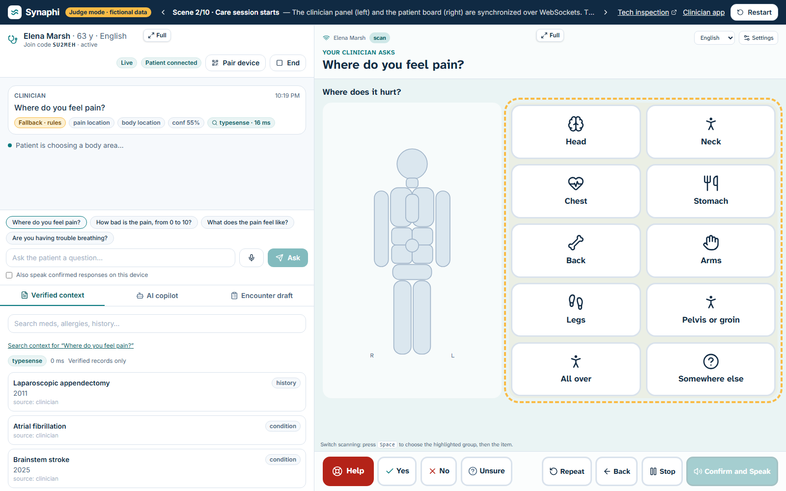
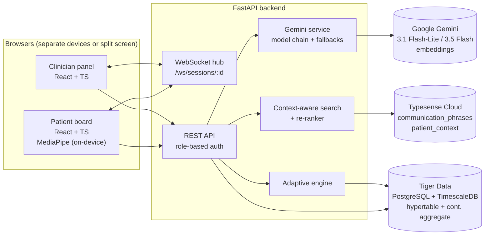

# Synaphi

**The Intelligent Patient Communication Platform** — hands-free, AI-assisted communication between patients who cannot speak and the clinicians caring for them.

Built for **EmoryHacks 2026** · Healthcare track · Coder for Good · Typesense · Gemini API · Tiger Data · Vultr · Entire

> Prototype. Synthetic patients only. Not a certified medical device; no HIPAA or clinical-validation claims.



---

## The problem

Patients who are intubated, paralysed, post-stroke, living with ALS or aphasia, or who don't share a language with their care team are routinely asked *"Where does it hurt?"* and cannot answer. Static picture boards are slow and generic; clinicians guess; important symptoms go unreported.

## What Synaphi does

1. A clinician asks a question — typed, dictated, or a one-tap quick question.
2. **Gemini** interprets it (intent, response type, plain-language and translated versions) — *only* to decide which answers to offer.
3. **Typesense** retrieves the most relevant answers from a curated 138-phrase medical communication library using context-aware hybrid (keyword + vector) search.
4. The patient sees large, pictogram cards in **their** language and answers with whatever they can reliably control: **switch scanning, deliberate blinks, head gestures, dwell, residual speech, keyboard, or touch**.
5. For pain, Synaphi walks through **location → precise area on a body diagram → intensity → quality**.
6. The patient reviews the composed sentence and chooses **Confirm and Speak**. Only then is it spoken aloud and shown on the clinician screen — in the clinician's language.
7. Every interaction is recorded as time-series data in **Tiger Data**, which drives *suggested* (never automatic) accessibility adjustments.

**The core rule:** AI helps choose what to *offer*. The patient decides what is *said*. The clinician decides what is *done*. Composed messages are built from deterministic templates and the patient's explicit selections — never from a model's guess.

---

## Feature status (verified, not aspirational)

| Area | Status | Evidence |
|---|---|---|
| Two-panel real-time session (WebSocket) | ✅ Working | E2E tests; p50 0.98 s question→patient device, 0.20 s confirm→clinician |
| Patient board: touch, keyboard, single-switch scanning | ✅ Working | E2E answers a question with **Space key only** |
| Dwell (hover-to-select) | ✅ Working | E2E selects with pointer rest only; move-to-rearm guard tested |
| Blink & head control (MediaPipe, on-device) | ✅ Implemented · ⚠️ verified with fake camera only | Model + WASM load under production CSP; detector logic unit-tested (debounce, hold, cooldown, hysteresis). **Needs a real-webcam check.** |
| Residual speech (browser speech recognition) | ✅ Implemented · ⚠️ not automatable | Chrome/Edge only |
| Text-to-speech of confirmed messages | ✅ Working | Browser speech synthesis |
| Urgent Help independent of AI | ✅ Working | Tested with all AI services disabled |
| Multilingual (en/es/fr/hi/zh) | ✅ Working | E2E: English question → Spanish board → patient answers → English to clinician |
| Gemini question interpretation | ✅ Live | 12/12 questions served by `gemini-3.1-flash-lite`, p50 819 ms |
| Gemini document extraction | ✅ Live | Fictional prescription PNG 9/9 fields, medication-list PDF 6/6, all **unverified** with source excerpts |
| Clinician copilot & encounter draft | ✅ Live (Gemini 3.5 Flash) | Editable; clinician approval required |
| Typesense hybrid search | ✅ Live | 138 phrases, built-in embeddings, synonym set; p50 15 ms |
| Tiger Data persistence + hypertable + continuous aggregate | ✅ Live | TimescaleDB 2.32, TLS verified |
| Adaptive accessibility suggestions | ✅ Working | Unit-tested; applied only after explicit confirmation |
| One-time QR device pairing | ✅ Working | Single-use enforced (test) |
| Docker / Compose / Caddy HTTPS / Vultr script | ✅ Written · ⚠️ not executed | No Docker on dev machine, no Vultr server yet |
| Gemini Live API | ❌ Unavailable | No `bidiGenerateContent` model on this key (404). Clinician speech uses browser recognition instead. |
| `gemini-3.8-flash` | ❌ Unavailable | Returns 504 for this key; automatic fallback chain used |

Full report: [docs/STATUS.md](docs/STATUS.md)

---

## Architecture



More: [docs/ARCHITECTURE.md](docs/ARCHITECTURE.md)

---

## Quick start (local)

Requirements: Python 3.12, Node 20+.

```bash
git clone https://github.com/ArnavS-05/emoryhacks26-ArnavS.git synaphi && cd synaphi
cp .env.example .env            # fill in keys (see docs/INTEGRATIONS.md); never commit .env

# backend
cd backend && python -m venv .venv
.venv/bin/pip install -r requirements.txt      # Windows: .venv\Scripts\pip
.venv/bin/uvicorn app.main:app --port 8000

# frontend (second terminal)
cd frontend && npm install && npm run dev       # http://localhost:5173
```

Open **http://localhost:5173/demo** for the guided judge demo. Clinician sign-in uses `CLINICIAN_ACCESS_CODE` from `.env`.

**No keys?** It still runs: SQLite replaces Tiger Data, a local matcher replaces Typesense, and a rule engine replaces Gemini. Every fallback is labelled in the UI (amber "Fallback" badges) — never presented as AI.

Production: `DOMAIN=your.domain docker compose up -d --build` — see [docs/DEPLOYMENT.md](docs/DEPLOYMENT.md).

---

## Routes

| Route | Who | What |
|---|---|---|
| `/demo` | Judges | Guided 10-scene split-screen demo with fictional data |
| `/inspect` | Judges | Live evidence of each integration (models verified, collections, hypertables) — no secrets |
| `/clinician` | Clinicians | Dashboard, patients, documents, sessions, analytics, search inspector, benchmark |
| `/join`, `/pair#…` | Patient device | Join by 6-character code or one-time QR link |

---

## Tests

| Suite | Count | Command |
|---|---|---|
| Backend (pytest) | 16 | `backend/.venv/bin/python -m pytest` |
| Frontend unit (vitest) | 12 | `cd frontend && npm test` |
| E2E demo flow (Playwright) | 1 flow, 7 checkpoints | `python tests/e2e/demo_flow.py` |
| E2E multi-device (Playwright) | 1 flow | `python tests/e2e/multidevice_flow.py` |
| Latency measurement | real API | `python scripts/measure_latency.py` |

Results and methodology: [docs/TESTING.md](docs/TESTING.md)

---

## Documentation

- [Accessibility design](docs/ACCESSIBILITY.md)
- [Sponsor integrations — Gemini, Typesense, Tiger Data, Vultr, Entire, Coder, GoDaddy](docs/INTEGRATIONS.md)
- [Privacy & clinical safety](docs/PRIVACY_AND_SAFETY.md)
- [Deployment (Docker, Vultr, custom domain)](docs/DEPLOYMENT.md)
- [Devpost submission](docs/DEVPOST.md) · [2-minute demo script](docs/DEMO_SCRIPT.md) · [DEV article draft](docs/DEV_ARTICLE.md)

