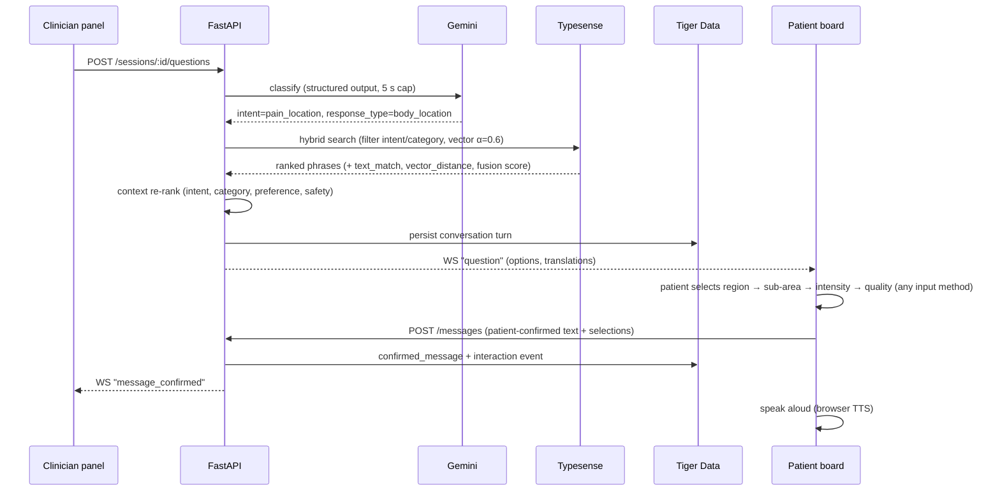

# Architecture

## Components

| Layer | Technology | Responsibility |
|---|---|---|
| Patient board | React 19, TypeScript, Tailwind v4, Zustand, MediaPipe Tasks Vision | Adaptive cards, input adapters, composer state machine, speech output |
| Clinician workspace | Same stack | Dashboard, records, document review, live session, copilot, encounter draft, analytics |
| API | FastAPI, Pydantic v2, SQLAlchemy 2 | REST + WebSocket, role-based auth, validation, rate limiting, audit log |
| AI | Google GenAI SDK | Question interpretation, translation, document extraction, copilot, encounter draft, embeddings |
| Search | Typesense Cloud 30.2 | `communication_phrases` (hybrid), `patient_context` (verified records only) |
| Data | Tiger Data (PostgreSQL 18 + TimescaleDB 2.32) | Records, sessions, messages, audit, `interaction_events` hypertable, `session_interaction_5m` continuous aggregate |
| Deploy | Docker multi-stage, Compose, Caddy | Single app container + automatic HTTPS |

## Request flow — "Where do you feel pain?"

## Key design decisions

- **AI never authors the patient's message.** `features/patient/composer.ts` is a pure state machine; sentences come from static, pre-translated templates (`lib/i18n.ts`) plus explicit selections. Unit-tested.
- **Every AI output carries its engine.** `ai_engine` / `engine` fields are `gemini-…` or `fallback:*`; the UI renders an amber "Fallback" badge for the latter.
- **Model fallback chain with circuit breaker** (`services/gemini_service.py`): a model that times out or returns 5xx/404 is skipped for 120 s. Real-time interpretation uses the low-latency model with a 5 s cap, then the rule engine.
- **Two-level switch scanning** (`features/accessibility/useScanner.ts`): groups (Help → answers → quick replies → controls) then items, so one switch reaches anything, and Help is one selection away in every cycle.
- **Pure gesture detectors** (`features/accessibility/detectors.ts`): blink hold + cooldown + hysteresis, head pose dwell + return-to-neutral; fed by MediaPipe blendshapes/landmarks; unit-tested without a camera.
- **Patient tokens are session-scoped** and cannot read the medical record; clinician tokens are signed (itsdangerous) and expire after 12 h.
- **Single uvicorn worker** because the WebSocket hub is in-process. Scaling out would move the hub to Redis/pub-sub.

## Data model

`patients`, `patient_profiles`, `accessibility_profiles`, `medical_documents`, `verified_medical_context` (status `unverified|verified|rejected`, source document + excerpt + confidence), `care_sessions`, `conversation_turns` (original/translated/simplified text, intent JSON, options, engine), `confirmed_messages`, `clinical_note_drafts`, `audit_events`, `pairing_tokens`, `interaction_events` (hypertable, PK `(id, ts)`).

Migrations are versioned and idempotent (`backend/app/migrations.py`, table `schema_migrations`); TimescaleDB steps run only on Tiger Data.
